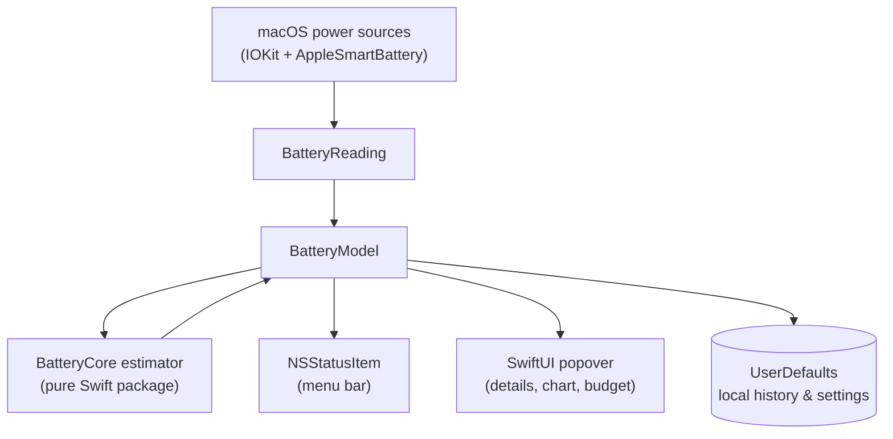

<div align="center">

# 🔋 BatteryTime

### Know your battery. Plan your time.

**A lightweight, privacy-first battery runtime estimator that lives in your macOS menu bar.**

[](https://www.apple.com/macos/)
[](https://www.swift.org/)
[](https://developer.apple.com/xcode/swiftui/)
[](#privacy)
[](https://github.com/AnkanBiswas514/BatteryTime---Time-Estimator-for-macintosh-mobile-systems/actions)

[Features](#-features) · [Install](#-install) · [How it works](#-how-it-works) · [Settings](#-settings) · [Development](#-development) · [Troubleshooting](#-troubleshooting)

</div>

---

## ✨ Overview

Battery percentage tells you *how much* charge is left, not *how long* it will last. **BatteryTime** measures how your Mac's stored energy actually changes over time, then turns that into a live runtime estimate, a power-draw reading, and a battery budget you can plan around.

It runs entirely on your Mac: no accounts, no cloud, no analytics, no third-party dependencies.

<!--
  Add screenshots here once captured, for example:

  <p align="center">
    
    
  </p>
-->

## 🚀 Features

| | Feature | What it does |
| :-: | --- | --- |
| ⏱️ | **Live time remaining** | Estimates runtime from recent changes in stored energy, not from percentage alone. |
| ⚡ | **Power draw & charging rate** | Shows estimated watts derived from battery energy measurements. |
| 📉 | **Smoothed predictions** | Blends a short (5 min) and a long (your averaging window) measurement to reduce noise. |
| 🎯 | **Confidence range** | Displays a likely range plus a qualitative confidence label. |
| 🧮 | **Battery budget** | Pick a target runtime and see whether your current draw is above or below the allowance. |
| 🧠 | **Workload indicator** | Classifies power-demand intensity from observed drain, without inspecting which apps you use. |
| 📈 | **24-hour power trend** | Charts recent battery draw and flags significant drain increases. |
| 🔄 | **Adaptive sampling** | Refreshes every 10, 30, or 60 seconds depending on activity and display state. |
| 🔌 | **Charging estimate** | Estimates time to full with a conservative taper adjustment near the top. |
| 🩺 | **Capacity history** | Keeps limited local snapshots of reported full-charge capacity. |
| 🍃 | **Low Power Mode control** | Reads the macOS setting and can toggle it, subject to system authorization. |
| 🎨 | **Status-aware icon** | Percentage drawn inside the battery. **Green** = charging, **Yellow** = Low Power Mode (takes priority). |
| 🖥️ | **Desktop Mac mode** | Gracefully falls back to a compact view on Macs without an internal battery. |

## 📦 Install

### Requirements

- macOS **13 Ventura** or later
- **Xcode 15** or later (to build from source)
- A Mac with an internal battery for the energy-based features

### Option 1: Run from Xcode

1. Clone the repository:
   ```bash
   git clone https://github.com/AnkanBiswas514/BatteryTime---Time-Estimator-for-macintosh-mobile-systems.git
   cd BatteryTime---Time-Estimator-for-macintosh-mobile-systems
   ```
2. Open **`BatteryTime.xcodeproj`** (XcodeGen is **not** required).
3. Select the **BatteryTime** scheme and the **My Mac** destination.
4. If Xcode asks for a signing team, choose one under **Signing & Capabilities**. A personal team is fine for local use.
5. Press **⌘R**.
6. Look in the **menu bar**, not the Dock. BatteryTime is a menu-bar-only app by design.

### Option 2: Install as a standalone app

1. Make sure Xcode's command-line tools point at the full Xcode:
   ```bash
   sudo xcode-select -s /Applications/Xcode.app/Contents/Developer
   ```
2. Build a Release copy and install it:
   ```bash
   xcodebuild -project BatteryTime.xcodeproj -scheme BatteryTime \
     -configuration Release -derivedDataPath build build
   cp -R build/Build/Products/Release/BatteryTime.app /Applications/
   ```
3. Apply the one-time framework fix described in
   [Known issue: standalone launch](#known-issue-standalone-launch), then:
   ```bash
   open -a /Applications/BatteryTime.app
   ```

### Launch at login

1. Open **System Settings → General → Login Items & Extensions**.
2. Under **Open at Login**, click **+** and choose `/Applications/BatteryTime.app`.

Or from Terminal:

```bash
osascript -e 'tell application "System Events" to make login item at end with properties {path:"/Applications/BatteryTime.app", hidden:false}'
```

> macOS starts login items **after you log in**, not at the raw boot stage.

## 🧠 How it works



**Energy.** On supported Macs, stored energy is derived from battery capacity and voltage:

```text
energy (Wh) = capacity (mAh) × voltage (mV) ÷ 1,000,000
```

**Power.** Draw is the rate at which that energy changes over a measurement window:

```text
power (W) = Δ energy (Wh) ÷ Δ time (h)
```

**Runtime.** Two windows are blended (60% recent 5-minute rate, 40% longer averaging-window rate) to react quickly without jumping around:

```text
remaining runtime (h) ≈ remaining energy (Wh) ÷ blended discharge power (W)
```

**Charging.** Time to full uses the same approach plus a conservative taper multiplier (×1.15, rising to ×1.5 above 80%), because charging slows near the top.

**Confidence.** The range widens when the short and long measurements disagree or when there are fewer than 10 minutes of data. It is a heuristic band, not a statistical interval.

**Battery budget.** Given a target runtime, the allowance is:

```text
allowed average draw (W) = remaining energy (Wh) ÷ target runtime (h)
```

BatteryTime compares your measured draw against it. It is guidance only and never changes your power settings.

**Adaptive sampling.** The poll interval is 30 s when the display is awake and usage is stable, 10 s when it is changing, and 60 s when the display is asleep.

## ⚙️ Settings

Open the menu bar popover and click **Settings…**.

| Setting | Options |
| --- | --- |
| Menu bar items | Icon, time estimate, power draw / charging rate |
| Averaging window | 10–30 minutes, in 5-minute steps |
| Start estimating after | 3, 5, or 10 minutes |
| Battery budget target | 1–24 hours, in 0.5-hour steps |

Right after launch or a power-state change, values may show **Learning**, **Calculating…**, or **Unavailable** while enough measurements are collected.

## 🛠️ Development

The repo contains an Xcode app project and a platform-independent Swift package for the estimation engine.

```text
BatteryTime.xcodeproj/        Xcode project and shared scheme
Sources/
  BatteryTime/                App: status item, popover, preferences, IOKit reader, model
  BatteryCore/                Pure Swift estimation engine (Estimator.swift)
Tests/
  BatteryCoreTests/           Estimator unit tests
.github/workflows/ci.yml      Tests + unsigned macOS build on every push and PR
Package.swift                 Swift package manifest for BatteryCore
project.yml                   Optional XcodeGen configuration
```

**Run the estimator tests** (no Xcode project needed):

```bash
swift test
```

The suite covers discharge rate and runtime, charging taper, invalid-sample handling, battery budget math, and bounded history.

**Build from Terminal:**

```bash
xcodebuild -project BatteryTime.xcodeproj -scheme BatteryTime \
  -configuration Debug -destination 'platform=macOS' \
  CODE_SIGNING_ALLOWED=NO build
```

`CODE_SIGNING_ALLOWED=NO` is for compile checks and CI only. It does not produce a distributable build. The CI workflow runs the tests and this build on a macOS runner.

## 🔒 Privacy

- No sign-in, cloud sync, telemetry, or analytics
- No per-app attribution and no process monitoring
- History and settings are stored locally via `UserDefaults`
- No network access is required for any feature
- No third-party dependencies

## ⚠️ Limitations & accuracy

- **Not a wattmeter.** Power is inferred from battery energy changes, not measured at the wall.
- **Hardware varies.** Some Macs or macOS versions don't expose the battery properties the estimator needs.
- **Estimates are heuristic.** The confidence range is not a calibrated probability interval.
- **Workload labels are approximate.** They describe observed demand, not which app caused it.
- **Charging is nonlinear.** Time-to-full can drift, especially near 100%.
- **Capacity history is not a diagnosis.** It is not a verified battery-health assessment.
- **Sleep and short windows.** Sleep-related gaps are excluded where detected, and the app needs time to learn after startup or a power-state change.

## 🧰 Troubleshooting

<details>
<summary><b>I launched the app but see no window or Dock icon</b></summary>

That is expected. BatteryTime is a menu-bar-only app. Check the right side of the menu bar. On MacBooks with a notch, a crowded menu bar can hide the icon, so hold <kbd>⌘</kbd> and drag other icons away, or quit a few. You can also confirm it is running:

```bash
pgrep -lf BatteryTime
```
</details>

<details id="known-issue-standalone-launch">
<summary><b>Known issue: standalone launch (double-clicking does nothing)</b></summary>

Running from Xcode (⌘R) works, but a copy installed in `/Applications` may crash immediately. The executable looks for `BatteryCore.framework` in `/Library/Frameworks` instead of inside the app bundle. You can confirm by running:

```bash
/Applications/BatteryTime.app/Contents/MacOS/BatteryTime
# dyld: Library not loaded: /Library/Frameworks/BatteryCore.framework/...
```

Point the executable at the bundled framework and re-sign locally:

```bash
install_name_tool -change \
  /Library/Frameworks/BatteryCore.framework/Versions/A/BatteryCore \
  @executable_path/../Frameworks/BatteryCore.framework/Versions/A/BatteryCore \
  /Applications/BatteryTime.app/Contents/MacOS/BatteryTime

codesign --force --deep --sign - /Applications/BatteryTime.app
open -a /Applications/BatteryTime.app
```

If the path differs, `otool -L /Applications/BatteryTime.app/Contents/MacOS/BatteryTime` lists the exact library path to replace. The patch applies to the installed copy only, so repeat it after each rebuild until the framework's install name is fixed in the project settings.
</details>

<details>
<summary><b>`xcodebuild` says it requires Xcode</b></summary>

Your active developer directory is the Command Line Tools. Switch it to full Xcode:

```bash
sudo xcode-select -s /Applications/Xcode.app/Contents/Developer
```

Or prefix a single command with `DEVELOPER_DIR=/Applications/Xcode.app/Contents/Developer`.
</details>

<details>
<summary><b>macOS blocks the app</b></summary>

A locally built app that you copied yourself is not notarized, so `spctl` reports it as rejected, which is normal for development builds. If macOS shows a prompt, review it under **System Settings → Privacy & Security**. Don't disable system security globally. For public distribution, archive, Developer ID sign, notarize, and staple the app.
</details>

<details>
<summary><b>The estimate says Calculating or Unavailable</b></summary>

Keep the Mac awake and unplugged for several minutes. Some hardware doesn't expose the energy fields this estimator needs, and desktop Macs have limited support.
</details>

<details>
<summary><b>Low Power Mode won't change</b></summary>

macOS may require administrator approval, and support varies by hardware and OS version.
</details>

## 🗺️ Ideas & roadmap

- [ ] Fix the `BatteryCore` framework install name so standalone builds launch without patching
- [ ] In-app **Launch at login** toggle (via `SMAppService`)
- [ ] Developer ID signed and notarized releases
- [ ] Screenshots and a short demo GIF
- [ ] Exportable power traces for estimator tuning

## 🤝 Contributing

Bug reports, documentation fixes, reproducible power traces, and estimator test cases are welcome. When opening an issue, include your macOS version, Mac model, what you expected, and what happened. Please avoid sharing personally identifying system information.

For code changes: keep the estimator testable, prefer native macOS APIs, and don't add network dependencies to the core app.

## 📄 License

No license has been selected yet, so standard copyright applies by default. Choose one (for example MIT or Apache-2.0) and add a `LICENSE` file before inviting reuse or redistribution.

---

<div align="center">

**BatteryTime** · Native macOS battery insights, without the cloud.

Made by [@AnkanBiswas514](https://github.com/AnkanBiswas514)

[⬆ Back to top](#-batterytime)

</div>
